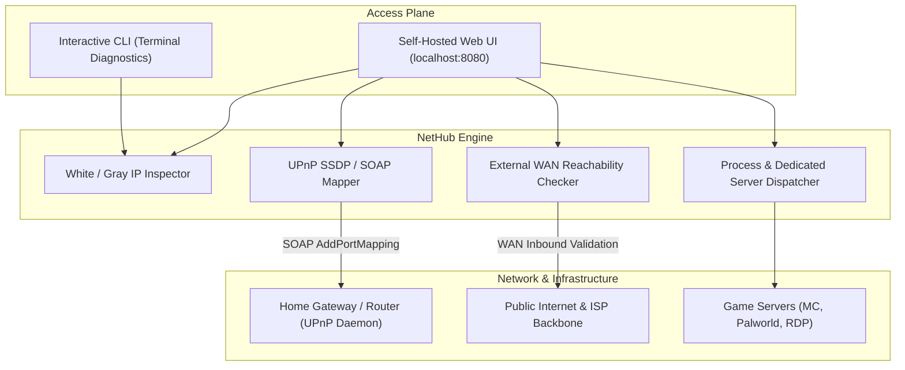

# NetHub

[Release-Badge]: https://img.shields.io/badge/release-v1.0.0-black?style=flat-square
[License-Badge]: https://img.shields.io/badge/license-MIT-black?style=flat-square
[Python-Badge]: https://img.shields.io/badge/python-3.10%2B-black?style=flat-square
[Platform-Badge]: https://img.shields.io/badge/platform-Windows%2011-black?style=flat-square
[Focus-Badge]: https://img.shields.io/badge/focus-White%20IP%20%26%20UPnP%20Self--Host-black?style=flat-square

![Release][Release-Badge]
![License][License-Badge]
![Python][Python-Badge]
![Platform][Platform-Badge]
![Focus][Focus-Badge]

> The definitive Windows 11 toolkit for detecting White (Public) vs Gray (CGNAT) IP addresses, 1-click UPnP router port forwarding without admin credentials, and maximizing self-hosted servers (Minecraft, Palworld, CS2, RDP).

---

## Overview

NetHub solves the single most common headache in local game server hosting and self-hosting: **"Do I have a White (Public) IP, or am I trapped behind my ISP's CGNAT?"** and **"How do I open ports without logging into my router?"**

- **Real-Time White vs Gray IP Inspector:** Instant classification of your public route (`WHITE_PUBLIC`, `GRAY_CGNAT`, or `PRIVATE`) with ISP name, AS number, and geolocation.
- **1-Click UPnP Automated Port Mapper:** Forwards game and service ports (Minecraft 25565, Palworld 8211, CS2 27015, RDP 3389) on your router instantly via UPnP SOAP protocols — zero router admin login required.
- **External WAN Reachability Engine:** Verifies whether internet clients can actually connect to your host through external network probes.
- **Bypass & Provisioning Playbook:** Practical guides for obtaining static IPs from major ISPs, plus zero-cost tunneling alternatives (Playit.gg, Cloudflare Tunnels, Tailscale).
- **Embedded Control Plane:** Pure dark industrial UI running in-process via FastAPI, secured by Google OAuth 2.0 with a single-click development mode.

---

## Architectural Topology



---

## Capability Matrix

| Capability | White (Public) IP | Gray (CGNAT) IP | How NetHub Solves It |
| :--- | :---: | :---: | :--- |
| Minecraft / Game Hosting | Native direct connect | Blocked by ISP | Automatic UPnP mapping for White IP; Playit.gg guide for Gray IP |
| Windows Remote Desktop (RDP) | Direct WAN access | Blocked by ISP | Port 3389 forwarding or Tailscale secure tunnel guide |
| Router Port Forwarding | Required | Ineffective | 1-Click UPnP forwarder (no 192.168.1.1 password needed) |
| Dynamic IP Stability | Changes on reboot | Shared pool | Dynamic DNS (DDNS / DuckDNS) configuration guide |
| ISP Status Diagnostic | Routable IPv4 | RFC 6598 (100.64.x.x) | Instant subnet and route analysis |

---

## Quickstart

### Option 1: Standalone Binary (Recommended)

Pre-compiled standalone executable located in `dist/`:

1. Launch `dist/NetHub.exe`.
2. A Windows terminal window will initialize and display your IP status.
3. Select `[1]` for Interactive CLI mode or `[2]` for Web Control Plane mode (`http://localhost:8080`).

### Option 2: Run from Source

```powershell
# Clone the repository
git clone https://github.com/your-username/nethub.git
cd nethub

# Install requirements
pip install -r requirements.txt

# Execute entrypoint
python main.py
```

---

## Pre-Configured UPnP Service Templates

NetHub provides built-in 1-click router port mapping for popular game servers and utilities:

- **Minecraft Java Edition:** TCP 25565
- **Palworld Dedicated Server:** UDP 8211
- **Counter-Strike 2 / Source:** UDP 27015
- **Valheim Dedicated Server:** UDP 2456
- **Terraria Multiplayer:** TCP 7777
- **Windows Remote Desktop (RDP):** TCP 3389
- **Jellyfin Media Server:** TCP 8096
- **Web / HTTP Server:** TCP 8080

---

## Verification & Testing

The test suite validates socket timeouts, IP classification, UPnP payloads, and FastAPI endpoints:

```powershell
python tests/test_core.py
python tests/test_web.py
```

---

## Security Model

- **Process Isolation:** Arbitrary shell commands are forbidden; execution is restricted strictly to whitelist entries in `config.json`.
- **Identity Gating:** Google OAuth 2.0 with email access control list (`allowed_emails`).
- **UPnP Guard:** Local broadcast scope only, preventing external tampering.

---

## License

Distributed under the [MIT License](LICENSE).

---

<div align="center">
<br/>

```text
       \`.
        \ \`.
     _..-`   `'--.._
   .'               `'.
  /   .-.       .-.    \       "The weak are destined to lie beneath
 |   /   \     /   \    |       the boots of the strong. If you wish
 |  |     |   |     |   |       to survive, master your network."
  \  \___/     \___/   /
   '.       _        .'             — General Esdeath (Akame ga Kill!)
     `'-.._____..-'`
```

<br/>
<sub>Engineered for maximum self-hosting performance. No emojis. Pure utility.</sub>
</div>
