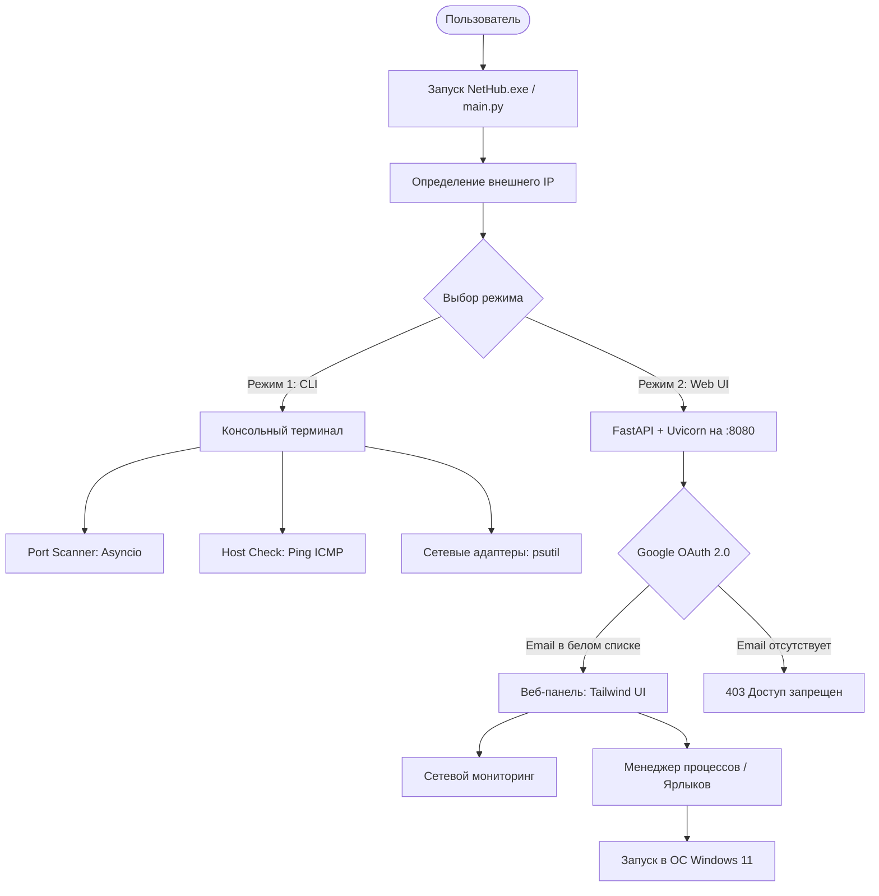

# ⚡ NetHub — Windows 11 Hybrid Network Toolkit

[](LICENSE)
[](https://www.python.org/)
[](https://www.microsoft.com/windows)
[](#)

**NetHub** — гибридная сетевая утилита для Windows 11, совмещающая интерактивный консольный терминал (**CLI**) и локальную веб-панель управления (**Web UI**) с поддержкой авторизации через **Google OAuth 2.0**.

---

## 🏗️ Архитектура системы



---

## 📁 Структура репозитория

```text
nethub/
│
├── .github/workflows/      # CI пайплайн (GitHub Actions)
│   └── ci.yml
├── config.example.json     # Шаблон конфигурации (без приватных данных)
├── config.json             # Локальный файл настроек (в .gitignore)
├── requirements.txt        # Список зависимостей Python
├── main.py                 # Точка входа в приложение
├── LICENSE                 # Открытая лицензия MIT
├── README.md               # Документация проекта
│
├── core/                   # Ядро утилиты
│   ├── config.py           # Загрузка и валидация настроек (Pydantic, sys.frozen)
│   ├── network.py          # Асинхронный сканер портов, ping, адаптеры Windows, внешний IP
│   └── launcher.py         # Безопасный запуск ярлыков (.lnk) и программ в Windows
│
├── cli/                    # Консольный интерфейс
│   └── terminal.py         # Интерактивное текстовое меню и команды
│
├── web/                    # Веб-панель (Self-Hosted Web UI)
│   ├── server.py           # FastAPI сервер, Google OAuth2, REST API эндпоинты
│   └── templates.py        # Встроенный современный HTML5/Tailwind CSS интерфейс
│
└── tests/                  # Автоматические тесты
    ├── test_core.py        # Тестирование сетевых утилит и лаунчера
    └── test_web.py         # Тестирование Web API маршрутов
```

---

## 🚀 Варианты запуска

### Вариант А: Запуск готового `.exe` (Без установки Python)
В папке `dist/` находится скомпилированный автономный исполняемый файл:

1. Перейдите в папку `dist/` и запустите `NetHub.exe`.
2. Автоматически откроется консольное окно Windows со всеми функциями.
3. Рядом с файлом автоматически создастся или подхватится `config.json`.

### Вариант Б: Запуск из исходного кода Python
```powershell
# 1. Установка зависимостей
pip install -r requirements.txt

# 2. Запуск утилиты
python main.py
```

---

## ⚙️ Настройка `config.json`

Скопируйте `config.example.json` в `config.json` и настройте под себя:

```json
{
  "server": {
    "host": "0.0.0.0",
    "port": 8080,
    "secret_key": "сгенерируйте-свой-секретный-ключ"
  },
  "google_oauth": {
    "client_id": "ВАШ_GOOGLE_CLIENT_ID.apps.googleusercontent.com",
    "client_secret": "ВАШ_GOOGLE_CLIENT_SECRET",
    "redirect_uri": "http://localhost:8080/auth/callback",
    "allowed_emails": [
      "user@gmail.com"
    ]
  },
  "apps": [
    {
      "id": "notepad",
      "name": "Блокнот",
      "path": "notepad.exe",
      "description": "Стандартный текстовый редактор"
    },
    {
      "id": "game",
      "name": "Моя Игра",
      "path": "C:\\Games\\MyGame.lnk",
      "description": "Ярлык запуска игры с рабочего стола"
    }
  ]
}
```

### 🛡️ Настройка Google OAuth 2.0:
1. Откройте [Google Cloud Console](https://console.cloud.google.com/).
2. Перейдите в **APIs & Services** → **Credentials**.
3. Создайте **OAuth 2.0 Client ID** (Web application).
4. В **Authorized redirect URIs** укажите: `http://localhost:8080/auth/callback`.
5. Скопируйте `client_id` и `client_secret` в `config.json` и укажите ваш Gmail в `allowed_emails`.
> **Подсказка:** Если OAuth-ключи не указаны, приложение автоматически работает в **Dev Mode** (режиме отладки), позволяя протестировать панель локально.

---

## 🧪 Запуск тестов

```powershell
python tests/test_core.py
python tests/test_web.py
```

---

## 📄 Лицензия

Проект распространяется под открытой лицензией [MIT](LICENSE).
