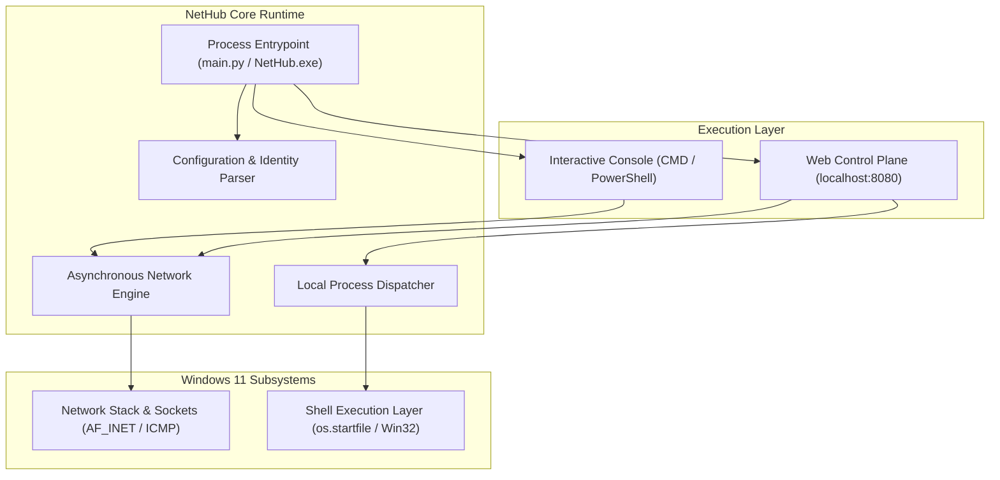

# NetHub

[Release-Badge]: https://img.shields.io/badge/release-v1.0.0-black?style=flat-square
[License-Badge]: https://img.shields.io/badge/license-MIT-black?style=flat-square
[Python-Badge]: https://img.shields.io/badge/python-3.10%2B-black?style=flat-square
[Platform-Badge]: https://img.shields.io/badge/platform-Windows%2011-black?style=flat-square
[Architecture-Badge]: https://img.shields.io/badge/architecture-hybrid%20cli%20%2B%20web-black?style=flat-square

![Release][Release-Badge]
![License][License-Badge]
![Python][Python-Badge]
![Platform][Platform-Badge]
![Architecture][Architecture-Badge]

> High-performance hybrid network diagnostics and background process manager for Windows 11. Combines an interactive sysadmin CLI with an embedded zero-dependency web control plane secured by Google OAuth 2.0.

---

## Overview

NetHub is an engineered Windows 11 network operations utility designed for system administrators, developers, and power users. It unifies low-latency network diagnostic primitives with local process orchestration under a single standalone binary.

- **Zero-Dependency Control Plane:** Embedded single-page dashboard styled with Tailwind CSS, running in-process via FastAPI and Uvicorn.
- **Asynchronous Concurrent Scanner:** High-throughput TCP socket verification with bounded worker semaphores powered by Python's native `asyncio`.
- **Identity-Gated Local Execution:** Strict email-whitelisted Google OAuth 2.0 access control with a zero-friction fallback development mode.
- **Controlled Process Dispatcher:** Safe host process and Windows shortcut (`.lnk`) execution constrained strictly to local access control lists.

---

## Architectural Topology



---

## Capability Matrix

| Feature | NetHub CLI Mode | NetHub Web UI Mode | Implementation Standard |
| :--- | :---: | :---: | :--- |
| Public Gateway Resolution | Supported | Supported | Multi-vendor fallback HTTP probing |
| TCP Port Scanner | Supported | Supported | Async socket connect (`asyncio.Semaphore`) |
| Host Reachability Check | Supported | Supported | ICMP echo request parsing (`ping.exe`) |
| Adapter Introspection | Supported | Supported | Subsystem query (`psutil.net_if_addrs`) |
| Remote Process Execution | Config-driven | UI One-Click | Windows Shell invocation (`os.startfile`) |
| Access Control | Local console | Google OAuth 2.0 | Whitelist validation (`allowed_emails`) |

---

## Quickstart

### Option 1: Standalone Binary (Recommended)

Pre-compiled standalone executable located in `dist/`:

1. Launch `dist/NetHub.exe`.
2. A Windows terminal window will initialize and display the primary network parameters.
3. Select `[1]` for Interactive CLI mode or `[2]` for Web Control Plane mode.

### Option 2: Run from Source

```powershell
# Clone the repository
git clone https://github.com/your-username/nethub.git
cd nethub

# Install requirements
pip install -r requirements.txt

# Execute entrypoint
python main.py
```

---

## Configuration Reference

NetHub reads its operational parameters from `config.json` adjacent to the executable or script root:

```json
{
  "server": {
    "host": "0.0.0.0",
    "port": 8080,
    "secret_key": "your-cryptographically-secure-key"
  },
  "google_oauth": {
    "client_id": "YOUR_CLIENT_ID.apps.googleusercontent.com",
    "client_secret": "YOUR_CLIENT_SECRET",
    "redirect_uri": "http://localhost:8080/auth/callback",
    "allowed_emails": [
      "administrator@gmail.com"
    ]
  },
  "apps": [
    {
      "id": "terminal",
      "name": "Windows Terminal",
      "path": "wt.exe",
      "description": "Windows Terminal Instance"
    },
    {
      "id": "ide",
      "name": "Visual Studio Code",
      "path": "code",
      "description": "Developer Workspace"
    }
  ]
}
```

### Google OAuth 2.0 Provisioning

1. Navigate to the [Google Cloud Console](https://console.cloud.google.com/).
2. Under **APIs & Services** &rarr; **Credentials**, create an **OAuth 2.0 Client ID** (Application type: *Web application*).
3. Append `http://localhost:8080/auth/callback` to **Authorized redirect URIs**.
4. Populate `client_id` and `client_secret` in `config.json`.
5. Specify authorized user accounts under `allowed_emails`.

*Note: When `client_id` is blank or unset, NetHub runs in Development Mode, permitting immediate local evaluation.*

---

## Verification & Testing

The test suite validates socket timeouts, process dispatch safety, configuration serialization, and FastAPI routing:

```powershell
python tests/test_core.py
python tests/test_web.py
```

---

## Security Model

- **Restricted Command Execution:** NetHub forbids arbitrary shell command strings from the network plane. Only pre-declared identifiers in `config.json` are eligible for dispatch.
- **Input Sanitization:** Host targets are validated against RFC-compliant regex patterns prior to shell subprocess execution.
- **Session Integrity:** Signed HTTP cookies with strict expiration cycles.

---

## License

Distributed under the [MIT License](LICENSE).

---

<div align="center">
<br/>

```text
       \`.
        \ \`.
     _..-`   `'--.._
   .'               `'.
  /   .-.       .-.    \       "The weak are destined to lie beneath
 |   /   \     /   \    |       the boots of the strong. If you wish
 |  |     |   |     |   |       to survive, master your network."
  \  \___/     \___/   /
   '.       _        .'             — General Esdeath (Akame ga Kill!)
     `'-.._____..-'`
```

<br/>
<sub>Maintained with rigorous engineering standards. No emojis. Pure performance.</sub>
</div>
