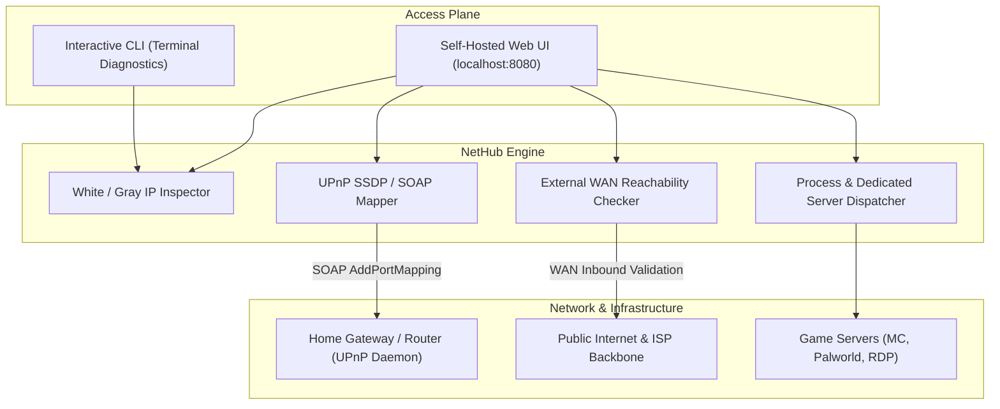

# NetHub

<div align="center">

[](https://github.com/Frozen-starTony/nethub/releases)
[](LICENSE)
[](https://www.python.org/)
[](https://www.microsoft.com/windows)
[](CONTRIBUTING.md)
[](ROADMAP.md)
[](#)

**Универсальная утилита Windows 11 для определения Белого IP, автоматического UPnP проброса портов роутера без паролей и удаленного хостинга серверов.**

**The definitive Windows 11 toolkit for detecting White (Public) vs Gray (CGNAT) IPs, 1-click UPnP router port forwarding, and self-hosted game servers.**

<br/>

[🇷🇺 **Читать инструкцию на русском языке**](#инструкция-на-русском-языке) &nbsp;•&nbsp; [🇬🇧 **Read English Documentation**](#english-documentation)

<br/>

</div>

---

> [!NOTE]
> ### 💬 От автора / Author's Note
> **RU:** Я ещё новичок в программировании, проект делал для себя и друзей, чтобы наконец решить вечную проблему: как понять, белый ли у тебя IP-адрес, как без мучений и логинов в 192.168.1.1 открыть порты для сервера Minecraft / Palworld / CS2 и как выжать максимум из своего интернета. Так что строго не судите! Буду очень рад звёздам ⭐, советам и идеям!
>
> **EN:** *I am still a beginner in programming! I built NetHub for myself and my friends to solve a persistent headache: checking whether you have a real Public (White) IP or are trapped behind CGNAT, opening router ports for Minecraft / Palworld / CS2 without needing router admin logins, and getting the most out of your home network. Please don't judge too strictly! Feedback and GitHub stars ⭐ are warmly appreciated!*

---

## Быстрые ссылки / Quick Links

- [📥 Скачать готовый NetHub.exe (v1.0.0)](https://github.com/Frozen-starTony/nethub/releases/latest)
- [📦 Исходный код на GitHub](https://github.com/Frozen-starTony/nethub)
- [🤝 Руководство для контрибьюторов / Contributing Guide](CONTRIBUTING.md)
- [🗺️ План развития / Roadmap](ROADMAP.md)
- [🛠 Шаблоны проброса портов](#предустановленные-шаблоны-портов)

---

# Инструкция на русском языке

## В чём главная проблема? (Белый IP vs Серый CGNAT)

Каждый, кто хоть раз пробовал создать сервер для друзей в **Minecraft, Palworld, CS2, Valheim, Rust** или включить **Удаленный рабочий стол (RDP)**, сталкивается с двумя вопросами:
1. **«Почему друзья не могут подключиться по моему IP?»**
2. **«Как открыть порты, если нет пароля от роутера (192.168.1.1) или лень в нём копаться?»**

Большинство современных провайдеров (Ростелеком, МТС, Дом.ру, Билайн, Мегафон и др.) экономят IPv4-адреса и сажают абонентов за **CGNAT (Carrier-Grade NAT)** — это так называемый **«Серый IP»** (диапазон RFC 6598: `100.64.0.0/10`). При Сером IP ни один человек из интернета не сможет напрямую подключиться к вашему компьютеру, сколько бы портов вы ни открывали на роутере.

**NetHub решает обе эти проблемы за секунды!**

---

## Ключевой функционал

- 🔍 **Мгновенный детектор типа IP:** За 1 секунду определяет, какой у вас IP:
  - `WHITE_PUBLIC` — настоящий Белый (публичный) IP. К вам можно подключиться отовсюду!
  - `GRAY_CGNAT` — Серый IP провайдера (`100.64.x.x` или внутренний NAT). Трафик блокируется провайдером.
  - `PRIVATE` — локальная сеть без прямого выхода.
  Выводит имя вашего провайдера, AS-номер, страну и город.
- ⚡ **1-Click UPnP проброс портов (Port Forwarding):** 
  Открывает нужные порты в роутере по протоколам UPnP SOAP **в один клик**. Вам **не нужно** заходить в панель управления роутером и вводить пароль от админки!
- 🌐 **Внешний верификатор доступности (WAN Check):**
  Проверяет реальную видимость вашего порта из внешней сети через независимый тестовый шлюз.
- 🚀 **Удаленный запуск игровых серверов:**
  Встроенный веб-интерфейс позволяет кнопками с телефона или другого ПК запускать серверы, ярлыки (`.lnk`) и батники (`.bat`).
- 🔒 **Защита доступа:**
  Авторизация через Google OAuth 2.0 (по белому списку email) или режим быстрой разработки.
- 🌍 **Автоопределение языка:**
  Консоль и веб-интерфейс автоматически подстраиваются под язык вашей операционной системы (Русский / English).

---

## Сравнительная таблица

| Возможность | Белый IP (Public) | Серый IP (CGNAT) | Как помогает NetHub |
| :--- | :---: | :---: | :--- |
| **Хостинг Minecraft / игр** | Работает напрямую | Блокируется провайдером | Авто-проброс UPnP для Белого IP; гайд по туннелям для Серого |
| **Удаленный стол Windows (RDP)** | Прямой доступ | Блокируется | Проброс порта 3389 или настройка защищенного Tailscale |
| **Проброс портов на роутере** | Требуется | Бесполезен на сером IP | 1-Click UPnP проброс (без знания пароля от 192.168.1.1) |
| **Стабильность при перезагрузке** | Динамический меняется | Общий пул NAT | Инструкция по привязке DDNS (DuckDNS / No-IP) |
| **Диагностика сети** | Маршрутизируемый IPv4 | RFC 6598 (100.64.x.x) | Мгновенный анализ подсети и шлюза |

---

## Как запустить NetHub

### Вариант 1: Готовый .exe файл (Рекомендуется)

1. Перейдите в раздел [Releases](https://github.com/Frozen-starTony/nethub/releases/latest) и скачайте `NetHub.exe`.
2. Запустите файл `NetHub.exe` двойным кликом.
3. Откроется окно терминала с информацией о вашем IP.
4. Выберите нужный режим:
   - Нажмите `1` — для работы прямо в консоли (сканирование портов, пинг, сетевой статус).
   - Нажмите `2` — для запуска веб-панели управления (`http://localhost:8080`).

### Вариант 2: Запуск из исходного кода (Python)

Требуется Python 3.10 или выше:

```powershell
# 1. Клонируйте репозиторий
git clone https://github.com/Frozen-starTony/nethub.git
cd nethub

# 2. Установите зависимости
pip install -r requirements.txt

# 3. Запустите утилиту
python main.py
```

---

## Предустановленные шаблоны портов

В NetHub встроены готовые шаблоны для проброса портов в 1 клик:

- **Minecraft (Java Edition):** TCP `25565`
- **Palworld Dedicated Server:** UDP `8211`
- **Counter-Strike 2 / Source:** UDP `27015`
- **Valheim Dedicated Server:** UDP `2456`
- **Terraria Multiplayer:** TCP `7777`
- **Windows Remote Desktop (RDP):** TCP `3389`
- **Jellyfin Media Server:** TCP `8096`
- **Локальный Web-сервер:** TCP `8080`

---

## Что делать, если у вас Серый IP?

Если NetHub показал статус `GRAY_CGNAT`, открыть порты в роутере бесполезно — соединения будет резать сам провайдер. Вот два рабочих пути:

1. **Официальный (Белый IP у провайдера):**
   - Позвоните в поддержку вашего провайдера (или зайдите в личный кабинет).
   - Подключите услугу «Статический публичный IP-адрес» (обычно стоит 50–150 руб./месяц).
   - Перезагрузите роутер — NetHub сразу покажет статус `WHITE_PUBLIC`, и вы сможете подключать друзей без ограничений.
2. **Бесплатные туннели (обход CGNAT):**
   - **Playit.gg:** Идеально для Minecraft и игр (создает публичный адрес без белого IP).
   - **Cloudflare Zero Trust / Tunnels:** Бесплатный туннель для веб-сервисов и ботов.
   - **Tailscale / WireGuard:** Защищенная виртуальная сеть для доступа к домашнему ПК и RDP.

---

## Настройка конфигурации (`config.json`)

В файле `config.json` можно настроить параметры утилиты:

```json
{
  "web_host": "0.0.0.0",
  "web_port": 8080,
  "default_ports": [22, 80, 443, 3389, 8080, 25565],
  "allowed_emails": ["your-email@gmail.com"],
  "shortcuts": [
    {
      "name": "Minecraft Server",
      "path": "C:\\Servers\\Minecraft\\start.bat",
      "working_dir": "C:\\Servers\\Minecraft"
    }
  ]
}
```

---
---

# English Documentation

## The Core Problem: Public (White) IP vs CGNAT (Gray) IP

Anyone who has tried hosting a self-hosted game server for friends in **Minecraft, Palworld, CS2, Valheim, or Rust**, or configuring **Windows Remote Desktop (RDP)**, eventually hits the same brick walls:
1. **"Why can't my friends connect to my external IP?"**
2. **"How do I open router ports without admin access to 192.168.1.1 or tedious manual NAT tables?"**

Most modern ISPs conserve IPv4 address space by placing residential clients behind **Carrier-Grade NAT (CGNAT)** (RFC 6598: `100.64.0.0/10`). Behind CGNAT, inbound traffic from the global Internet cannot reach your home network, regardless of how many ports you forward on your local router.

**NetHub diagnoses, tests, and solves this entire workflow in seconds.**

---

## Key Features

- 🔍 **Real-Time IP Route Classification:** Instantly detects whether your IP is:
  - `WHITE_PUBLIC`: Truly routable public IPv4 address. Direct incoming traffic is possible!
  - `GRAY_CGNAT`: Trapped behind ISP CGNAT (`100.64.x.x` or shared NAT pool).
  - `PRIVATE`: Isolated private subnet.
  Displays your ISP organization, AS number, country, and city.
- ⚡ **1-Click UPnP Automated Port Mapper:**
  Opens designated ports directly on your home router via UPnP SOAP protocols **without logging into the router administration interface**.
- 🌐 **External WAN Reachability Checker:**
  Validates if your opened ports are truly reachable from outside the local network via independent verification nodes.
- 🚀 **Remote Process & Server Launcher:**
  Execute server startup scripts, batch files, and application shortcuts (`.lnk`) safely through the web interface with status tracking.
- 🔒 **Identity Gating & Safety:**
  Google OAuth 2.0 authentication with an explicit email whitelist, or single-click local development mode.
- 🌍 **Automatic Language Detection:**
  The terminal CLI and Web UI automatically detect and match your operating system language (English / Russian).

---

## Architectural Topology



---

## Installation & Usage

### Option 1: Pre-Built Standalone Binary (Recommended)

1. Download `NetHub.exe` from [GitHub Releases](https://github.com/Frozen-starTony/nethub/releases/latest).
2. Double-click `NetHub.exe`.
3. The console will display your detected IP classification.
4. Choose your operational mode:
   - Type `1` for the interactive terminal CLI.
   - Type `2` to start the Web Control Panel (`http://localhost:8080`).

### Option 2: Running from Source

```powershell
# Clone the repository
git clone https://github.com/Frozen-starTony/nethub.git
cd nethub

# Install Python requirements
pip install -r requirements.txt

# Launch NetHub
python main.py
```

---

## What to Do If You Are Behind CGNAT

If NetHub reports your connection as `GRAY_CGNAT`, manual router port forwarding will not work because the ISP firewall drops incoming requests. Two solutions exist:

1. **Request a Public (White) IP from your ISP:**
   - Contact your ISP customer support or check your account dashboard.
   - Subscribe to a "Dedicated Public Static/Dynamic IP" (typically \$1–\$3/month).
   - Restart your router; NetHub will confirm `WHITE_PUBLIC` status immediately.
2. **Use Zero-Cost Inbound Tunnels:**
   - **Playit.gg:** Free, zero-configuration tunnel tailored for Minecraft and game servers.
   - **Cloudflare Zero Trust / Tunnels:** Best for web APIs and dashboards.
   - **Tailscale / WireGuard:** Encrypted peer-to-peer overlay network for remote management and RDP.

---

## Verification & Testing

Run the automated test suite covering network classifiers, UPnP SOAP handlers, and FastAPI endpoints:

```powershell
python tests/test_core.py
python tests/test_web.py
```

---

## License

Distributed under the [MIT License](LICENSE).

---

<div align="center">

### Special Dedication

> *"The weak are destined to lie beneath the boots of the strong. If you wish to survive, master your network."*
> 
> — **General Esdeath** (*Akame ga Kill!*)

❄️ *Dedicated to the ice queen. Engineered for maximum self-hosting performance.*

<sub>NetHub &copy; 2026. Made with passion for network autonomy.</sub>

</div>
